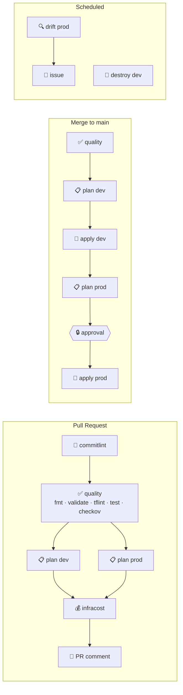

# 🎛️ tf-painel

[🇧🇷 Português](README.md) · **🇺🇸 English**

[](https://github.com/LucasCA-Git/tf-painel/actions/workflows/deploy.yml)
[](https://github.com/LucasCA-Git/tf-painel/actions/workflows/pull-request.yml)
[](https://github.com/LucasCA-Git/tf-painel/actions/workflows/release.yml)


[](https://www.conventionalcommits.org)
[](LICENSE)

A **Terraform-on-AWS CI/CD control panel** built on GitHub Actions. The pipeline is the product: every stage shows up in the Actions graph and can be **toggled, skipped and approved** from the panel, while the infrastructure (VPC + EC2 + optional ALB) ships to **dev** and **prod** through OIDC — no access keys anywhere.

> Study and portfolio project by [Lucas Cardoso Alecrim](https://github.com/LucasCA-Git) — DevOps Engineer. Code is in English; inline comments and design docs are in Portuguese.

## ✨ Highlights

- 🔐 **No static credentials**: GitHub OIDC with a read-only *plan* role and an *apply* role that can only be assumed from inside a GitHub Environment.
- 🎛️ **Panel with controls**: `workflow_dispatch` checkboxes, persistent per-environment feature flags and a manual approval gate for prod.
- 📋 **Saved plan = applied plan**: apply consumes the plan artifact and never re-plans.
- 🛡️ **Quality & security**: `fmt`, `validate`, `tflint`, `terraform test` (mocked provider) and `checkov` with SARIF in the Security tab.
- 💰 **Cost guardrails**: NAT/ALB off by default, **nightly destroy of dev**, Infracost on PRs and a budget alert.
- 🌪️ **Daily drift detection** that opens and closes issues on its own.
- 🏷️ **Conventional Commits + release-please**: automatic CHANGELOG and semver tags.
- 🧭 Planned with the **BMAD** method (brief → architecture → epics), decisions recorded as **ADRs**.

## 🗺️ The panel



| Workflow | Trigger | What it does |
|---|---|---|
| [`Pull Request`](.github/workflows/pull-request.yml) | PR to `main` | commitlint, quality gate, dev/prod plans, cost and a single sticky PR comment |
| [`Deploy`](.github/workflows/deploy.yml) | push to `main` | quality → apply dev → **approval** → apply prod |
| [`Control Panel`](.github/workflows/control-panel.yml) | manual | pick environment, action (`plan`/`apply`/`destroy`) and stages |
| [`Drift Detection`](.github/workflows/drift-detection.yml) | daily 11:00 UTC | plan on prod; opens/updates/closes a `drift` issue |
| [`Nightly Destroy`](.github/workflows/nightly-destroy.yml) | daily 02:00 UTC | destroys dev to save money |
| [`Release`](.github/workflows/release.yml) | push to `main` | release-please: CHANGELOG + tag |

### 🎚️ Controls

**Per run** — Actions → *Control Panel* → *Run workflow*:

| Input | Type | Effect |
|---|---|---|
| Environment | `dev` / `prod` | run target |
| Action | `plan` / `apply` / `destroy` | `destroy` requires typing `destroy-<environment>` |
| Run quality gate | checkbox | toggles fmt, validate, tflint and tests |
| Run checkov | checkbox | toggles the security scan |

**Persistent** — *Settings → Secrets and variables → Actions → Variables* (see [ADR-0004](docs/adr/0004-persistent-infra-toggles.md)):

| Variable | Default | Effect |
|---|---|---|
| `DEV_ENABLE_NAT_GATEWAY` / `PROD_…` | `false` | NAT Gateway; the EC2 moves to a private subnet (~US$32/month) |
| `DEV_ENABLE_ALB` / `PROD_…` | `false` | public Application Load Balancer (~US$16/month) |
| `DEV_INSTANCE_TYPE` / `PROD_…` | `t3.micro` | instance type (allow-listed in the module) |
| `ENABLE_CHECKOV` | `true` | security scan on PR/deploy |
| `ENABLE_INFRACOST` | `false` | cost estimate on PRs (needs `INFRACOST_API_KEY` secret) |
| `ENABLE_DRIFT_DETECTION` | `false` | enables scheduled drift detection |
| `ENABLE_NIGHTLY_DESTROY` | `true` | enables the nightly destroy of dev |

```bash
# Example: turn on the ALB in dev and apply through the panel
gh variable set DEV_ENABLE_ALB --body true
gh workflow run "Control Panel" -f environment=dev -f action=apply
```

## 🏗️ Infrastructure

- **network** — multi-AZ VPC, subnets computed with `cidrsubnet`, optional single NAT, locked default SG, optional flow logs.
- **compute** — Amazon Linux 2023, **IMDSv2 required**, encrypted EBS, **no SSH** (SSM only), SG with no ingress except from the ALB, optional ALB with health checks.
- **bootstrap** — state bucket (versioned, encrypted, TLS-only, S3 native locking), OIDC provider, least-privilege plan/apply roles, a **permissions boundary** for every role the environments create, and an AWS Budget.

## 🚀 Getting started

1. **Bootstrap (once, locally)**
   ```bash
   cd bootstrap
   cp terraform.tfvars.example terraform.tfvars   # set the budget e-mail
   terraform init && terraform apply
   terraform output -raw github_variables_commands | bash
   ```
2. **GitHub Environments** — create `dev` and `prod`; restrict *Deployment branches* to `main` on **both** (the apply role trusts the environment, not the branch) and enable *Required reviewers* on **prod**.
3. **Optional secrets** — `INFRACOST_API_KEY` (cost on PRs) and `RELEASE_PLEASE_TOKEN` (fine-grained PAT so the release PR is authored by you and triggers checks).
4. **Local dev** — `pre-commit install`, then `terraform -chdir=modules/network test`.

## 💰 Cost

| Scenario | Monthly estimate |
|---|---|
| Default: prod 24/7 + dev daytime only, no NAT/ALB | ~US$13–16 (t3.micro ~US$7.6 + public IPv4 ~US$3.6 + EBS per running env) |
| Using `t4g.micro` (Graviton) | ~20% less on EC2 |
| + ALB in one environment | +~US$16 |
| + NAT Gateway in one environment | +~US$32 + data |

Rough `us-east-1` figures; check Infracost on the PR.

## 🧭 Decisions

[ADR index](docs/adr/README.md) · [BMAD brief](docs/bmad/briefs/brief-tf-painel-2026-10-20/brief.md) · [Architecture](docs/bmad/architecture.md) · [Epics & stories](docs/bmad/epics-and-stories.md)

## 📄 License
[MIT](LICENSE) © Lucas Cardoso Alecrim
