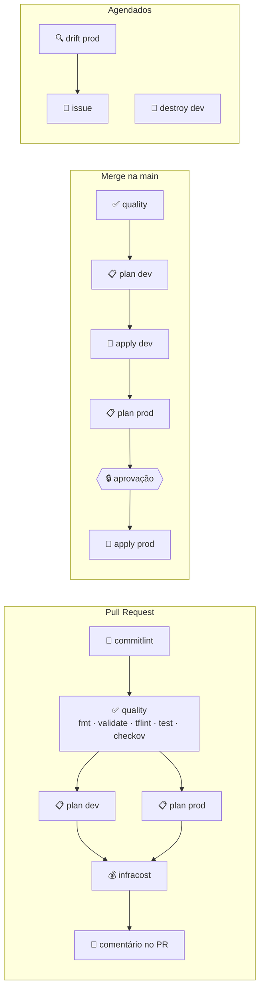
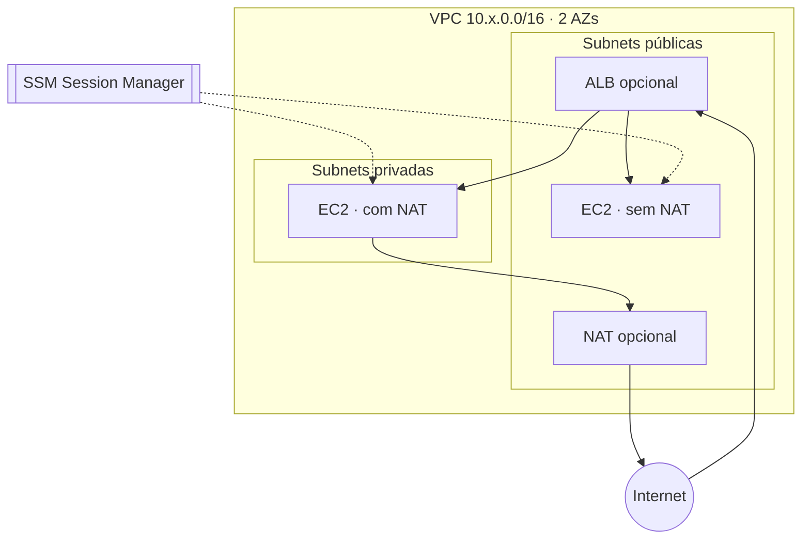

# 🎛️ tf-painel

**🇧🇷 Português** · [🇺🇸 English](README.en.md)

[](https://github.com/LucasCA-Git/tf-painel/actions/workflows/deploy.yml)
[](https://github.com/LucasCA-Git/tf-painel/actions/workflows/pull-request.yml)
[](https://github.com/LucasCA-Git/tf-painel/actions/workflows/release.yml)


[](https://www.conventionalcommits.org)
[](LICENSE)

Painel de controle de **CI/CD para Terraform na AWS**, construído sobre o GitHub Actions. O pipeline é o produto: cada estágio aparece no grafo do Actions e pode ser **ligado, desligado e aprovado** pelo painel, enquanto a infraestrutura (VPC + EC2 + ALB opcional) é entregue em **dev** e **prod** com OIDC, sem nenhuma access key.

> Projeto de estudo e portfólio de [Lucas Cardoso Alecrim](https://github.com/LucasCA-Git) — DevOps Engineer.

## ✨ Destaques

- 🔐 **Zero credenciais estáticas**: GitHub OIDC com role de *plan* (somente leitura) e role de *apply* que só pode ser assumida dentro de um GitHub Environment.
- 🎛️ **Painel com controles**: `workflow_dispatch` com checkboxes, feature flags persistentes por ambiente e aprovação manual para prod.
- 📋 **Plan salvo = plan aplicado**: o apply consome o artefato do plan, nunca re-planeja.
- 🛡️ **Qualidade e segurança**: `fmt`, `validate`, `tflint`, `terraform test` (provider mockado) e `checkov` com SARIF na aba Security.
- 💰 **Custo sob controle**: NAT/ALB desligados por padrão, **destroy noturno do dev**, Infracost no PR e budget alert.
- 🌪️ **Drift detection** diário que abre e fecha issues sozinho.
- 🏷️ **Conventional Commits + release-please**: CHANGELOG e tags semver automáticos.
- 🧭 Planejado com o método **BMAD** (brief → arquitetura → épicos) e decisões registradas em **ADRs**.

## 🗺️ O painel



| Workflow | Gatilho | O que faz |
|---|---|---|
| [`Pull Request`](.github/workflows/pull-request.yml) | PR para `main` | commitlint, quality gate, plan de dev/prod, custo e comentário único no PR |
| [`Deploy`](.github/workflows/deploy.yml) | push na `main` | quality → apply dev → **aprovação** → apply prod |
| [`Control Panel`](.github/workflows/control-panel.yml) | manual | escolhe ambiente, ação (`plan`/`apply`/`destroy`) e estágios |
| [`Drift Detection`](.github/workflows/drift-detection.yml) | diário 08:00 BRT | plan em prod; abre/atualiza/fecha issue `drift` |
| [`Nightly Destroy`](.github/workflows/nightly-destroy.yml) | diário 23:00 BRT | destrói o dev para economizar |
| [`Release`](.github/workflows/release.yml) | push na `main` | release-please: CHANGELOG + tag |

### 🎚️ Controles

**Por execução** — Actions → *Control Panel* → *Run workflow*:

| Input | Tipo | Efeito |
|---|---|---|
| Ambiente | `dev` / `prod` | alvo da execução |
| Ação | `plan` / `apply` / `destroy` | `destroy` exige digitar `destroy-<ambiente>` |
| Rodar quality gate | checkbox | liga/desliga fmt, validate, tflint e testes |
| Rodar checkov | checkbox | liga/desliga o scan de segurança |

**Persistentes** — *Settings → Secrets and variables → Actions → Variables* (ver [ADR-0004](docs/adr/0004-persistent-infra-toggles.md)):

| Variável | Padrão | Efeito |
|---|---|---|
| `DEV_ENABLE_NAT_GATEWAY` / `PROD_…` | `false` | NAT Gateway; a EC2 passa para subnet privada (~US$ 32/mês) |
| `DEV_ENABLE_ALB` / `PROD_…` | `false` | Application Load Balancer público (~US$ 16/mês) |
| `DEV_INSTANCE_TYPE` / `PROD_…` | `t3.micro` | tipo da instância (lista permitida no módulo) |
| `ENABLE_CHECKOV` | `true` | scan de segurança no PR/deploy |
| `ENABLE_INFRACOST` | `false` | estimativa de custo no PR (requer secret `INFRACOST_API_KEY`) |
| `ENABLE_DRIFT_DETECTION` | `false` | liga o drift detection agendado |
| `ENABLE_NIGHTLY_DESTROY` | `true` | liga o destroy noturno do dev |

```bash
# Exemplo: ligar o ALB no dev e aplicar pelo painel
gh variable set DEV_ENABLE_ALB --body true
gh workflow run "Control Panel" -f environment=dev -f action=apply
```

## 🏗️ Infraestrutura



- **network** — VPC multi-AZ, subnets calculadas com `cidrsubnet`, NAT único opcional, default SG travado, flow logs opcionais.
- **compute** — Amazon Linux 2023, **IMDSv2 obrigatório**, EBS criptografado, **sem SSH** (acesso via SSM), SG sem nenhuma entrada exceto do ALB, ALB opcional com health check.
- **bootstrap** — bucket de state (versionado, criptografado, TLS-only, lock nativo do S3), provedor OIDC, roles de plan/apply com least privilege, **permissions boundary** para toda role criada pelos ambientes e AWS Budget.

## 🚀 Como usar

### Pré-requisitos
Conta AWS, [Terraform ≥ 1.10](https://developer.hashicorp.com/terraform/install), [AWS CLI](https://aws.amazon.com/cli/), [GitHub CLI](https://cli.github.com/) e (opcional) [pre-commit](https://pre-commit.com/).

### 1. Bootstrap (uma vez, localmente)
```bash
cd bootstrap
cp terraform.tfvars.example terraform.tfvars   # ajuste o e-mail do budget
terraform init
terraform apply
terraform output -raw github_variables_commands | bash   # configura as variáveis do repo
```

### 2. GitHub Environments
Em *Settings → Environments*, crie `dev` e `prod`. Nos **dois**, em *Deployment branches*, permita só a `main` (a role de apply confia no environment, não na branch). Em **prod**, ative também *Required reviewers* (você mesmo).

### 3. Opcionais
| Secret | Para quê |
|---|---|
| `INFRACOST_API_KEY` | custo no PR (`ENABLE_INFRACOST=true`) |
| `RELEASE_PLEASE_TOKEN` | PAT fine-grained para o Release PR sair em seu nome e rodar os checks |

### 4. Desenvolvimento local
```bash
pre-commit install            # hooks de fmt, validate, tflint, actionlint e commitlint
terraform -chdir=modules/network test
terraform -chdir=modules/compute test
```

## 💰 Custo

| Cenário | Estimativa mensal |
|---|---|
| Padrão: prod 24/7 + dev só durante o dia, sem NAT/ALB | ~US$ 13–16 (EC2 t3.micro ~US$ 7,6 + IPv4 público ~US$ 3,6 + EBS por ambiente ligado) |
| Usando `t4g.micro` (Graviton) | ~20% a menos na EC2 |
| + ALB em um ambiente | +~US$ 16 |
| + NAT Gateway em um ambiente | +~US$ 32 + tráfego |

Valores aproximados para `us-east-1`; confira com o Infracost no PR. Contas novas podem usar créditos do Free Tier.

## 📁 Estrutura

```
bootstrap/          state remoto, OIDC, roles e budget
modules/network/    VPC + testes
modules/compute/    EC2 + ALB + testes
envs/{dev,prod}/    root modules por ambiente
.github/workflows/  painel (workflows reutilizáveis _quality e _terraform)
docs/adr/           decisões de arquitetura
docs/bmad/          brief, arquitetura e épicos (método BMAD)
```

## 🧭 Decisões

| ADR | Decisão |
|---|---|
| [0001](docs/adr/0001-github-oidc-two-roles.md) | GitHub OIDC com duas roles |
| [0002](docs/adr/0002-s3-native-state-locking.md) | Lock nativo do S3, sem DynamoDB |
| [0003](docs/adr/0003-cost-aware-networking.md) | Rede orientada a custo |
| [0004](docs/adr/0004-persistent-infra-toggles.md) | Flags de infra persistentes por ambiente |
| [0005](docs/adr/0005-conventional-commits-and-release-please.md) | Conventional Commits + release-please |

## 🛣️ Roadmap
HTTPS com ACM + Route 53 · Auto Scaling Group · NAT instance (fck-nat) · multi-conta com Organizations · Terratest. Veja [épicos e stories](docs/bmad/epics-and-stories.md).

## 📄 Licença
[MIT](LICENSE) © Lucas Cardoso Alecrim
