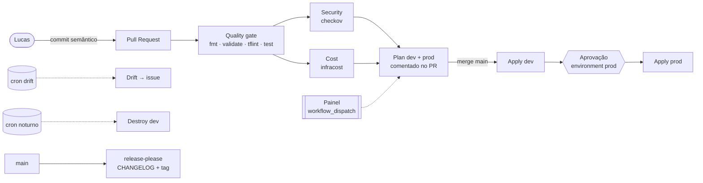

# Arquitetura — tf-painel

## 1. Visão geral



O **painel** é o grafo do GitHub Actions. Cada caixa acima é um job visível; os controles são:

| Controle | Mecanismo | Escopo |
|---|---|---|
| Ambiente, ação (`plan`/`apply`/`destroy`), ligar/desligar estágios | `workflow_dispatch` inputs (checkbox/choice) | uma execução |
| Estágios opcionais (`ENABLE_CHECKOV`, `ENABLE_INFRACOST`, `ENABLE_DRIFT_DETECTION`, `ENABLE_NIGHTLY_DESTROY`) | Repository Variables | todas as execuções |
| Recursos de infra caros (`DEV_ENABLE_NAT_GATEWAY`, `PROD_ENABLE_ALB`, `DEV_INSTANCE_TYPE`…) | Repository Variables com prefixo do ambiente | por ambiente, persistente |
| Gate humano | Environment `prod` com *required reviewers* | apply/destroy em prod |
| Visibilidade | `$GITHUB_STEP_SUMMARY` + comentário no PR | por execução |

> Por que flags de infra são variáveis persistentes e não inputs do dispatch? Ver [ADR-0004](../adr/0004-persistent-infra-toggles.md): se um apply manual ligasse o ALB por input, o próximo deploy da `main` o destruiria. A flag precisa ser **persistente** e lida por todo workflow que aplica.

## 2. Estrutura do repositório

```
.
├── bootstrap/                 # aplicado 1x localmente: state S3, OIDC, roles, budget
├── modules/
│   ├── network/               # VPC, subnets públicas/privadas, IGW, NAT opcional
│   │   └── tests/             # terraform test com mock_provider
│   └── compute/               # EC2 via SSM, SG, IAM, ALB opcional
│       └── tests/
├── envs/
│   ├── dev/                   # root module do ambiente (backend parcial)
│   └── prod/
├── .github/
│   ├── workflows/
│   │   ├── _quality.yml       # reusable: fmt/validate/tflint/test/checkov
│   │   ├── _terraform.yml     # reusable: plan → (apply|destroy) por ambiente
│   │   ├── pull-request.yml   # PR: commitlint + quality + infracost + plan
│   │   ├── deploy.yml         # push main: dev → aprovação → prod
│   │   ├── control-panel.yml  # painel manual
│   │   ├── drift-detection.yml
│   │   ├── nightly-destroy.yml
│   │   └── release.yml
│   └── scripts/               # scripts usados pelos workflows
└── docs/{adr,bmad}/
```

## 3. Infraestrutura

### 3.1 Bootstrap (fora do pipeline)
- Bucket S3 `tf-painel-state-<account_id>`: versionado, criptografado (SSE-S3), *public access block*, TLS obrigatório, lifecycle de versões antigas.
- Lock: **lock nativo do S3** (`use_lockfile = true`), sem DynamoDB ([ADR-0002](../adr/0002-s3-native-state-locking.md)).
- Provedor OIDC `token.actions.githubusercontent.com`.
- Roles ([ADR-0001](../adr/0001-github-oidc-two-roles.md)):
  - `tf-painel-gha-plan`: `ReadOnlyAccess` + leitura do state e escrita só no lockfile. Confia em `pull_request` e `ref:refs/heads/main`.
  - `tf-painel-gha-apply`: política customizada (EC2/ELB/IAM só para `tf-painel-{dev,prod}-*` com permissions boundary/state). Confia **apenas** em `environment:dev` e `environment:prod`.
- Permissions boundary `tf-painel-workload-boundary`: teto de permissões de toda role criada pelos ambientes.
- AWS Budget mensal com alerta por e-mail (80% real / 100% previsto).

### 3.2 Módulo `network`
- VPC `/16`, N AZs (padrão 2), subnets pública e privada por AZ calculadas com `cidrsubnet`.
- IGW; route table pública; route tables privadas.
- `enable_nat_gateway` (padrão `false`): 1 NAT único (custo) quando ligado.
- Default security group travado (sem regras), flow logs opcionais.

### 3.3 Módulo `compute`
- EC2 Amazon Linux 2023 (AMI via SSM Parameter), IMDSv2 obrigatório, EBS criptografado, sem key pair.
- Acesso **somente via SSM Session Manager** (role com `AmazonSSMManagedInstanceCore`).
- Posicionamento ([ADR-0003](../adr/0003-cost-aware-networking.md)):
  - NAT ligado → subnet **privada**, sem IP público.
  - NAT desligado → subnet **pública** com IP público para saída, **nenhuma** regra de entrada (exceto do ALB).
- `enable_alb` (padrão `false`): ALB HTTP nas subnets públicas, target group com health check `/health`.
- `user_data` instala nginx com página de status (ambiente, versão).

### 3.4 Ambientes
`envs/dev` e `envs/prod` são root modules finos que compõem `network` + `compute`, com backend S3 parcial (`key` fixo, `bucket` injetado pelo CI). Diferenças por `terraform.tfvars` (CIDR, flow logs) e pelas flags `<ENV>_*` (ADR-0004).

## 4. Pipeline

### 4.1 Autenticação
`permissions: id-token: write` só nos jobs que falam com a AWS; `aws-actions/configure-aws-credentials` com `role-to-assume`. Nenhuma access key em secrets.

### 4.2 Fluxos
| Evento | Workflow | Jobs |
|---|---|---|
| `pull_request` | `pull-request.yml` | commitlint → quality (matrix por diretório) → checkov* → infracost* → plan dev/prod → comentário único atualizado |
| `push main` | `deploy.yml` | quality → plan+apply dev → plan prod → **aprovação** → apply prod |
| `workflow_dispatch` | `control-panel.yml` | inputs → quality? → checkov? → plan → apply/destroy? |
| `schedule` diário | `drift-detection.yml` | plan `-detailed-exitcode` em prod → abre/atualiza issue `drift` |
| `schedule` noturno | `nightly-destroy.yml` | destroy dev (se `ENABLE_NIGHTLY_DESTROY`) |
| `push main` | `release.yml` | release-please (CHANGELOG + tag semver) |

\* condicionado a flag.

### 4.3 Garantias
- **Plan salvo = plan aplicado**: o apply consome o artefato `tfplan` do job de plan (mesmo run), nunca re-planeja.
- `concurrency` por ambiente, sem cancelamento em andamento (evita state corrompido).
- Versões de Terraform/tflint fixadas; actions fixadas por tag major.
- Permissões mínimas por job (`contents: read` por padrão).

## 5. Convenções
- Código e identificadores em inglês; comentários em português.
- Conventional Commits (`feat`, `fix`, `ci`, `docs`, `test`, `chore`, `refactor`) com escopos: `bootstrap`, `network`, `compute`, `envs`, `ci`, `bmad`.
- Autor único dos commits: Lucas Cardoso Alecrim.
- Tags padrão em todos os recursos via `default_tags`: `Project`, `Environment`, `ManagedBy`, `Repository`.
